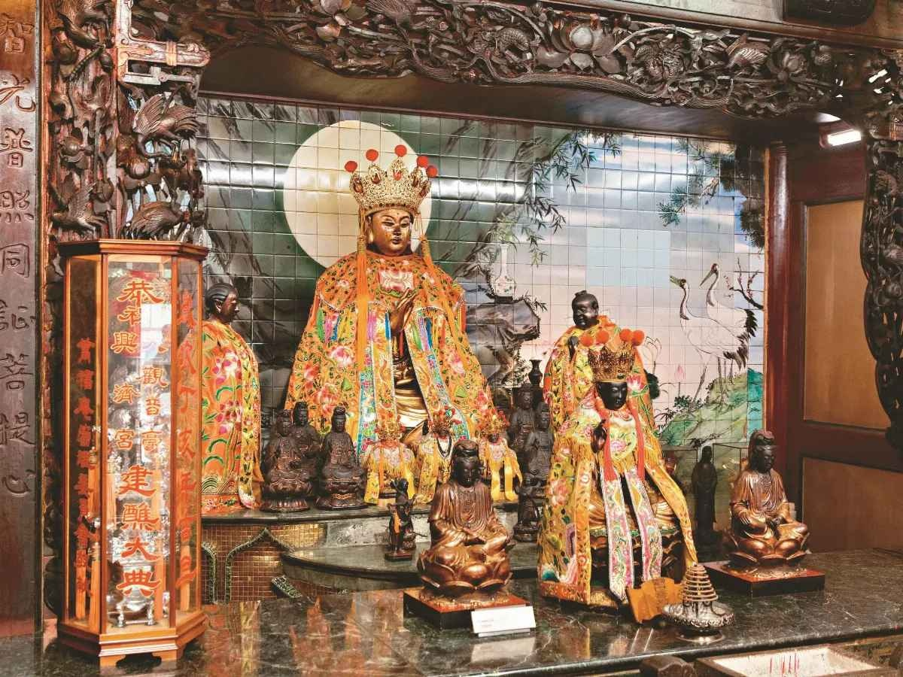

# [GY-03] 正殿主祀 — 觀世音菩薩主神龕

> **明永曆年間創建，逾三百年香火鼎盛之慈悲信仰核心**

- **導覽編號**：`GY-03` (網址錨點：`#GY-03`)
- **所屬區域**：大觀音亭 — 正殿中央主龕
- **主題標籤**：`主祀神尊` `明永曆創建` `慈航普渡`
- **展覽照片**：`./GY03_大觀音亭_正殿觀世音菩薩主神龕.jpg`

## 一、導覽摘要（繁體中文）
大觀音亭為全臺歷史最悠久的觀音廟之一。主龕鎮殿觀音菩薩頭戴五佛冠、結跏趺坐於蓮花寶座，神態慈悲莊嚴，脅侍善財與龍女。

## 二、完整導覽內文（語音朗讀全文）
大觀音亭相傳創建於明鄭永曆年間（早於1678年），主祀觀世音菩薩（俗稱觀音佛祖、觀音媽）。正殿金碧輝煌的木雕神龕內，鎮殿觀世音菩薩頭戴五佛寶冠，面龐豐潤慈祥，雙眼微垂俯視眾生，象徵「千處祈求千處應，苦海常作渡人舟」的廣大悲願。神龕兩側脅侍為善財童子與龍女，龕前並供奉多尊開基與分靈觀音金身，長年受香煙繚繞熏染，呈現溫潤深邃的古樸光澤。每年農曆二月十九（觀音誕辰）、六月十九（得道日）、九月十九（出家日）三大聖誕，更有盛大的「觀音佛祖平安宴」與佛誕祝壽科儀。

## 三、藝術與信仰看點
- 五佛冠鎮殿金身：法相莊嚴慈祥，垂目凝視信眾，展現明清以來府城佛教造像美學。
- 善財龍女脅侍：左脅侍善財童子象徵五十三參求法精神，右脅侍龍女象徵頓悟成佛、眾生平等。
- 清代御賜與名宦古匾：殿內高懸「慈航普渡」、「大慈大悲」等歷代古匾，見證三百年香火傳承。

---

## 四、多國語言版本 (Multilingual Content)

### English (`en`)
- **Title**: Main Hall Deities — Avalokitesvara (Guanyin Bodhisattva) Central Shrine
- **Subtitle**: Founded in the Ming Yongli era, the compassionate spiritual heart with over 300 years of incense heritage
- **Location**: Da Guanyin Pavilion — Main Hall Central Shrine
- **Summary**: One of Taiwan's oldest Guanyin temples. The main Guanyin Bodhisattva wears a Five-Buddha Crown and sits in lotus posture with serene compassion, flanked by Sudhana and Dragon Girl.
- **Full Guide**: Founded during the Ming Zheng Yongli period (before 1678), Da Guanyin Pavilion enshrines Avalokitesvara Bodhisattva (Guanyin Mazu) as its principal deity. Inside the sumptuously gilded woodcarved main shrine, the presiding Guanyin wears a Five-Buddha Crown with a serene, compassionate countenance and downcast eyes watching over sentient beings, embodying the vow: 'Answering prayers everywhere, serving as a boat across the sea of suffering.' Flanked by Sudhana and Dragon Girl, and accompanied by historic founding statues darkened by centuries of incense smoke, the temple celebrates Guanyin's three major festival days on the 19th of the 2nd, 6th, and 9th lunar months.
  - Five-Buddha Crown Statue: Serene and majestic with downcast eyes, exemplifying Ming-Qing Tainan Buddhist sculptural aesthetics.
  - Sudhana & Dragon Girl: Sudhana symbolizes tireless pursuit of truth (53 visits), while Dragon Girl represents sudden enlightenment and equality of all beings.
  - Historic Plaques: Adorned with Qing-dynasty plaques such as 'Universal Salvation on the Boat of Compassion', witnessing 300+ years of devotion.

### 日本語 (`ja`)
- **名称**: 正殿主祀 — 観世音菩薩主神龕
- **副題**: 明代永暦年間創建、三百年以上の香火を受け継ぐ慈悲信仰の中心
- **場所**: 大観音亭 — 正殿中央主龕
- **概要**: 台湾最古級の観音廟の一つ。主龕の観音菩薩は五仏宝冠を戴き蓮華座に結跏趺坐し、善財童子と龍女を脇侍に従え慈悲深い威容を誇る。
- **本文**: 大観音亭は明鄭永暦年間（1678年以前）の創建と伝わり、観世音菩薩（観音仏祖・観音媽）を主祀としています。正殿の絢爛たる木彫神龕の中央には、五仏宝冠を戴く鎮殿観音菩薩が蓮華座に坐し、柔和な眼差しで衆生を見守り、「千処の祈りに千処で応え、苦海を渡す舟となる」大慈悲の誓願を体現しています。両脇には善財童子と龍女が侍立し、前方の案卓には三百年以上の香煙で味わい深い古色を帯びた開基観音像が祀られています。旧暦2月19日・6月19日・9月19日の三大縁日には盛大な祝寿法要と「平安宴」が執り行われます。
  - 五仏冠の鎮殿金身：慈愛に満ちた伏し目の表情が、明清以来の府城仏教彫刻の美意識を伝える。
  - 善財童子と龍女：左脇侍の善財童子は求道精神を、右脇侍の龍女は頓悟成仏と衆生平等を象徴。
  - 歴代扁額の伝承：殿内には「慈航普渡」「大慈大悲」などの古匾が掲げられ、三百年の信仰の歴史を物語る。

### 한국어 (`ko`)
- **명칭**: 정전 주신 — 관세음보살 주감실
- **부제**: 명나라 영력 연간 창건, 300년 이상 향불이 이어져 온 자비 신앙의 중심
- **위치**: 대관음정 — 정전 중앙 주감실
- **요약**: 대만에서 가장 오래된 관음묘 중 하나입니다. 주감실의 관세음보살은 오불보관을 쓰고 연화좌에 결가부좌하여 자비롭고 장엄한 자태를 보여주며, 선재동자와 용녀가 협시하고 있습니다.
- **본문**: 대관음정은 명정(明鄭) 영력 연간(1678년 이전)에 창건된 것으로 전해지며 관세음보살(관음불조·관음마)을 주신으로 모십니다. 정전의 화려한 목조 감실 중앙에는 오불보관을 쓴 진전 관세음보살이 풍만하고 자애로운 얼굴로 중생을 굽어보며 '천 곳에서 기도하면 천 곳에서 응답하고 고해에서 사람을 건지는 배가 되리라'는 대자대비의 서원을 보여줍니다. 양옆에는 선재동자와 용녀가 협시하고 있으며, 감실 앞에는 수백 년간 향연에 그을려 깊은 고색을 띤 개기 관음상들이 모셔져 있습니다. 매년 음력 2월 19일, 6월 19일, 9월 19일 삼대 길일에는 성대한 축수 의례와 평안연이 열립니다.
  - 오불관 진전 금신: 자애롭게 눈을 내리깔고 중생을 바라보는 모습에서 명·청 이래 대만부성 불교 조각 미학을 엿볼 수 있습니다.
  - 선재동자와 용녀 협시: 선재동자는 구법 정신을, 용녀는 돈오성불과 중생 평등을 상징합니다.
  - 역대 고현액: 전내에 걸린 '자항보도(慈航普渡)', '대자대비(大慈大悲)' 등의 옛 현액이 300년 신앙 역사를 증명합니다.
