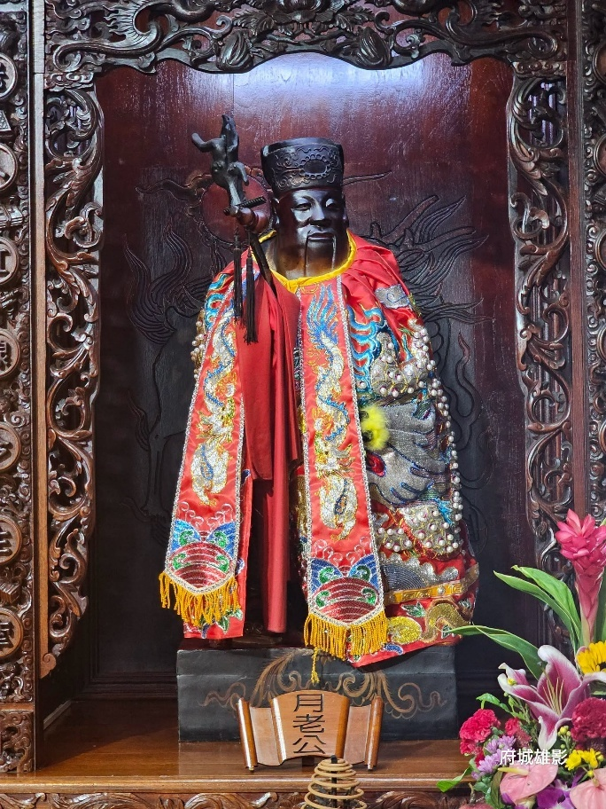

# [GY-04] 府城四大月老 — 闊嘴月老公神尊

> **嘴闊耳厚、舌燦蓮花，專司說媒牽線、促成良緣正果**

- **導覽編號**：`GY-04` (網址錨點：`#GY-04`)
- **所屬區域**：大觀音亭 — 後殿（大雄寶殿）左側月老龕
- **主題標籤**：`府城四大月老` `說媒牽紅線` `求姻緣聖地`
- **展覽照片**：`./GY04_大觀音亭_闊嘴月老公神尊.jpg`

## 一、導覽摘要（繁體中文）
名列臺南府城四大月老之一，造型最大特色為「嘴闊耳厚」，象徵善於說媒、傾聽心願，能跨越距離為有情人說合良緣。

## 二、完整導覽內文（語音朗讀全文）
大觀音亭供奉的月下老人（俗稱月老公），與臺灣祀典武廟、大天后宮、重慶寺並列為「府城四大月老」。本亭月老公神像造型極具特色：面帶喜氣笑容、嘴部比例特別寬闊，且雙耳垂肩厚實，因此被信眾尊稱為「闊嘴月老」。民間信仰認為「嘴闊吃四方、善說媒」，代表月老公口才極佳、舌燦蓮花，特別擅長為已經有交往對象、或渴望締結正緣的男女說合提親；而「耳厚」則象徵能耐心傾聽善男信女的感情心事。求得聖筊後請領紅線，過香爐順時針繞三圈隨身佩帶，靈驗事蹟遍傳海內外。

## 三、藝術與信仰看點
- 闊嘴耳厚特徵：嘴闊代表說媒口才極佳、能說動人心；耳厚代表慈悲傾聽信眾良緣祈求。
- 求紅線標準儀軌：稟報姓名、生辰、地址與理想條件，擲出聖筊後抽取紅線過爐順時針繞三圈。
- 佛道交融特色：在佛教觀音亭內供奉道教姻緣神月老，展現臺灣民間信仰「觀音賜福、月老牽線」的圓融智慧。

---

## 四、多國語言版本 (Multilingual Content)

### English (`en`)
- **Title**: Tainan's Four Great Matchmakers — Wide-Mouthed Yue Lao (God of Marriage)
- **Subtitle**: Wide-mouthed and thick-eared with silver-tongued eloquence, famed for matchmaking and lasting marriages
- **Location**: Da Guanyin Pavilion — Rear Hall (Mahavira Hall), Left Yue Lao Shrine
- **Summary**: One of Tainan's Four Great Yue Lao deities, distinguished by his 'wide mouth and thick ears'—symbolizing persuasive matchmaking and attentive listening to lovers' prayers.
- **Full Guide**: Enshrined in Da Guanyin Pavilion, Yue Lao (the Old Man Under the Moon) is celebrated as one of 'Tainan's Four Great Yue Lao' alongside the Martial Temple, Grand Matsu Temple, and Chongqing Temple. What makes this statue unique is his joyful smile, notably wide mouth, and thick, pendulous ears—earning him the affectionate title 'Wide-Mouthed Yue Lao'. Folk belief holds that a wide mouth signifies extraordinary eloquence in matchmaking, making him especially efficacious in bringing couples toward marriage and bridging long-distance relationships, while his thick ears listen patiently to heartfelt wishes. Worshippers who receive a confirming divination block draw a blessed red thread and circle it three times clockwise over the incense burner.
  - Wide Mouth & Thick Ears: Wide mouth represents persuasive matchmaking; thick ears symbolize compassionate listening to prayers.
  - Red Thread Ritual: State your name, birth date, address, and ideal partner criteria; after throwing a confirming Jiaobei, draw a red thread and circle the burner 3 times clockwise.
  - Buddhist-Taoist Harmony: Enshrining the Taoist matchmaking deity inside a Buddhist Guanyin temple embodies Taiwanese religious inclusivity.

### 日本語 (`ja`)
- **名称**: 府城四大月老 — 闊嘴（大きな口）の月老公神尊
- **副題**: 大きな口と福耳を持ち、巧みな弁舌で良縁を取り持つ縁結びの神
- **場所**: 大観音亭 — 後殿（大雄宝殿）左側月老龕
- **概要**: 台南府城四大月老の一尊。最大の特徴は「大きな口と厚い耳」で、願いに耳を傾け、巧みな言葉で遠く離れた縁も結ぶとされる。
- **本文**: 大観音亭に祀られる月下老人（月老公）は、祀典武廟・大天后宮・重慶寺と並び「府城四大月老」と称されます。当亭の月老公は、満面の笑みを浮かべた「大きな口（闊嘴）」と肩まで垂れる「福耳（耳厚）」が最大の特徴で、「闊嘴月老」として親しまれています。大きな口は弁舌が巧みで縁談をまとめる力（仲人上手）に優れ、厚い耳は参拝者の恋の悩みに優しく耳を傾けることを象徴します。聖筊（神意の許し）を得て赤い糸（紅線）を授かり、香炉の上で時計回りに三回巡らせて身につけると良縁が結ばれると広く信仰されています。
  - 闊嘴耳厚の特徴：大きな口は縁談をまとめる卓越した弁舌を、厚い耳は参拝者の願いを聞き届ける慈悲を表す。
  - 紅線祈願の作法：氏名・生年月日・住所と理想の相手を告げ、聖筊を得たら赤い糸を引き、香炉で時計回りに3回巡らせる。
  - 仏道習合の魅力：仏教の観音亭に道教の縁結びの神を祀り、「観音様が福を授け、月老が縁を結ぶ」台湾民間信仰の寛容さを体現。

### 한국어 (`ko`)
- **명칭**: 부성 4대 월하노인 — 입이 큰 '활취(闊嘴) 월하노인' 신존
- **부제**: 입이 크고 귀가 두툼하며 뛰어난 언변으로 중매와 백년가약을 성사시키는 인연의 신
- **위치**: 대관음정 — 후전(대웅보전) 좌측 월하노인 감실
- **요약**: 타이난 부성 4대 월하노인 중 한 분으로, '넓은 입과 두툼한 귀(闊嘴耳厚)'가 특징이며 소원을 잘 듣고 뛰어난 언변으로 좋은 인연을 맺어줍니다.
- **본문**: 대관음정에 모셔진 월하노인(월노공)은 사전무묘, 대천후궁, 중경사와 함께 '타이난 부성 4대 월하노인'으로 꼽힙니다. 이곳 월하노인 신상의 가장 큰 특징은 환한 미소와 유난히 넓은 입(闊嘴), 그리고 어깨까지 드리운 두툼한 귀(耳厚)로, 신도들 사이에서 '활취 월하노인'이라 불립니다. 넓은 입은 언변이 뛰어나 중매를 잘 성사시킴을 뜻하며, 두툼한 귀는 청춘남녀의 연애 고민을 인내심 있게 들어줌을 상징합니다. 성교(점괘)의 허락을 받아 붉은 실(홍선)을 뽑은 뒤 향로 위에서 시계 방향으로 세 바퀴 돌려 지니면 좋은 배필을 만난다고 전해집니다.
  - 활취이후(闊嘴耳厚) 특징: 넓은 입은 마음을 움직이는 뛰어난 중매 언변을, 두툼한 귀는 소원을 경청하는 자비심을 나타냅니다.
  - 홍선 기원 의례: 이름, 생년월일, 주소와 이상형을 고하고 성교가 나오면 붉은 실을 뽑아 향로에서 시계 방향으로 3바퀴 돌립니다.
  - 불도 융합의 미학: 불교 사찰인 관음정에 도교 인연신 월하노인을 모셔 '관음이 복을 내리고 월하노인이 인연을 맺어준다'는 포용적 신앙을 보여줍니다.
