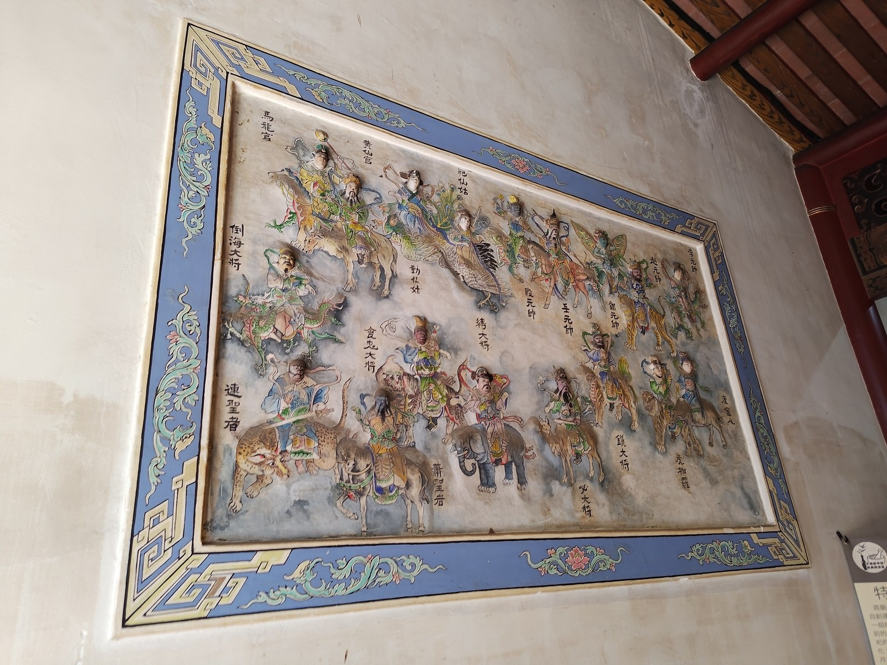

# [A06] 神將雲集 — 水磨泥塑三十六官將壁堵

> **於水磨磚牆上立體浮塑保生大帝與觀音護法官將，人物坐騎姿態萬千**

- **導覽編號**：`A06` (網址錨點：`#A06`)
- **所屬區域**：大觀音亭 — 三川殿與廊牆壁堵
- **主題標籤**：`三十六官將` `水磨泥塑浮雕` `佛道護法交融`
- **展覽照片**：`./A06_大觀音亭_水磨泥塑三十六官將壁堵.jpg`

## 一、導覽摘要（繁體中文）
在平整光滑的水磨青磚牆面上，以素雅卻立體感十足的石灰泥塑，雕琢出駕馭瑞獸、手執法器的三十六官將，展現府城傳統壁堵藝術的高超水準。

## 二、完整導覽內文（語音朗讀全文）
「三十六官將」（如紀仙姑、康元帥、趙元帥、鄧元帥、高元帥等）原為道教保生大帝（及媽祖、王爺）駕前護法神將，但在大觀音亭與祀典興濟宮這座「佛道共祀」的建築群中，兩廟壁堵巧妙地以「水磨泥塑」技法呈現官將雲集的壯觀場面。匠師在不施濃艷彩繪的純白石灰泥塑與青灰磚牆之間，純粹依靠衣褶線條的深淺起伏、武將甲冑的肌理，以及獅、虎、豹、鶴、麒麟等坐騎的騰躍動勢，營造出「神兵天降、護佑道場」的立體視覺效果。這種留白與立體浮雕結合的表現手法，盡顯清代與日治時期府城匠師洗鍊雅致的審美格調。

## 三、藝術與信仰看點
- 素雅灰白對比美學：不施重彩，以白灰泥塑襯托青灰水磨磚底，凸顯光影與立體雕工。
- 人物與瑞獸坐騎生動：每位官將手持不同法器（劍、鐧、鎚、圈、旗），坐騎神態各異。
- 佛道兩廟藝術呼應：將保生大帝三十六官將題材延伸於兩廟壁堵，體現神佛護法一家的空間觀。

---

## 四、多國語言版本 (Multilingual Content)

### English (`en`)
- **Title**: Celestial Retinue — Polished Stucco Thirty-Six Official Generals Wall Relief
- **Subtitle**: Three-dimensional stucco reliefs on water-polished brick walls depicting the Thirty-Six Official Generals on celestial mounts
- **Location**: Da Guanyin Pavilion — Sanchuan Hall & Corridor Wall Reliefs
- **Summary**: Sculpted in monochrome lime stucco atop smooth water-polished blue bricks, these dynamic reliefs portray the Thirty-Six Official Generals riding auspicious beasts and wielding ritual weapons.
- **Full Guide**: The 'Thirty-Six Official Generals' (such as Immortal Maiden Ji and Marshals Kang, Zhao, Deng, and Gao) are traditionally Taoist guardian generals serving Baosheng Dadi. Yet within the intertwined Da Guanyin Pavilion and Xingji Temple complex, the corridor wall panels celebrate this shared protective pantheon through refined 'water-polished lime stucco' reliefs. Foregoing gaudy polychrome paint, the master artisans relied purely on the interplay of ivory-white lime stucco against blue-gray polished brick—using deep undercutting, flowing robe folds, detailed armor textures, and leaping mounts (lions, tigers, leopards, cranes, and qilin) to evoke celestial generals descending from the clouds.
  - Monochrome Contrast Aesthetics: Ivory lime stucco set against blue-gray brick highlights pure sculptural form and shadow.
  - Lively Generals & Mounts: Each general wields a distinct weapon (sword, mace, hammer, ring, banner) atop an expressive mythical mount.
  - Artistic Unity Across Both Temples: Extends the Thirty-Six Generals motif across the shared architectural fabric.

### 日本語 (`ja`)
- **名称**: 神将雲集 — 水磨泥塑「三十六官将」壁堵
- **副題**: 水磨き煉瓦壁の上に立体的に造形された護法「三十六官将」、多彩な人物と霊獣の躍動美
- **場所**: 大観音亭 — 三川殿・回廊壁堵
- **概要**: 滑らかな水磨き青磚の壁面に、素朴ながら立体感あふれる漆喰彫刻で霊獣に跨り法器を手にする三十六官将を表現した、台南壁堵芸術の名作。
- **本文**: 「三十六官将」（紀仙姑・康元帥・趙元帥・鄧元帥など）は本来、保生大帝に仕える道教の護法神将ですが、仏道共祀の大観音亭と興済宮においては、回廊の壁堵に「水磨泥塑」技法で生き生きと表現されています。極彩色の塗装を施さず、青灰色の水磨き煉瓦を背景に白漆喰の陰影と立体感だけで、武将の甲冑や翻る衣、獅子・虎・豹・鶴・麒麟といった霊獣の躍動感を見事に彫り出しています。余白の美と精緻な高浮彫が調和した、台南の名工ならではの雅致あふれる壁堵芸術です。
  - 清楚なモノクロームの美：彩色を抑え、青磚の背景に白漆喰の立体造形を浮かび上がらせる上品な意匠。
  - 多彩な武将と霊獣：剣・鎚・旗など異なる法器を手に、個性豊かな瑞獣に乗る官将たちを緻密に表現。
  - 両廟をつなぐ芸術テーマ：三十六官将のモチーフが両廟の空間に呼応し、神仏一体の守護世界を築く。

### 한국어 (`ko`)
- **명칭**: 신장운집 — 수마니소 '삼십육관장(三十六官將)' 벽도
- **부제**: 수마 벽돌 벽면 위에 입체적으로 빚어낸 호법 '36관장' 부조로, 다채로운 인물과 영수의 역동미가 일품
- **위치**: 대관음정 — 삼천전 및 회랑 벽도
- **요약**: 매끄러운 수마 청전 벽면 위에 소박하면서도 입체감이 뛰어난 석회 니소 기법으로 서수를 타고 법기를 든 36관장을 조각한 타이난 벽도 예술의 명작입니다.
- **본문**: '삼십육관장(三十六官將)'(기선고, 강원수, 조원수, 등원수 등)은 본래 도교 보생대제를 호위하는 신장들이지만, 불도공사 사원인 대관음정과 흥제궁에서는 회랑 벽도에 '수마니소' 기법으로 장관(壯觀)을 이루며 표현되어 있습니다. 화려한 채색을 배제하고 청회색 수마 벽돌을 배경으로 순백색 석회 부조의 음영과 입체감만을 활용하여 무장의 갑옷, 휘날리는 옷자락, 사자·호랑이·표범·학·기린 등 탈것(좌기)의 역동적인 움직임을 정교하게 조각했습니다. 여백의 미와 고부조 기법이 어우러진 타이난 장인들의 세련된 미감을 보여줍니다.
  - 단아한 흑백 대비 미학: 짙은 채색 없이 청회색 벽돌 배경 위에 백회 부조를 부각시켜 빛과 그림자, 입체 조각미를 극대화했습니다.
  - 생동감 넘치는 신장과 서수: 검, 철퇴, 깃발 등 각기 다른 법기를 들고 개성 넘치는 서수를 탄 관장들의 모습이 치밀하게 묘사되어 있습니다.
  - 양묘를 잇는 예술적 호응: 36관장 모티프가 두 사원의 공간에 어우러지며 신불(神佛) 호법 일체의 세계관을 보여줍니다.
