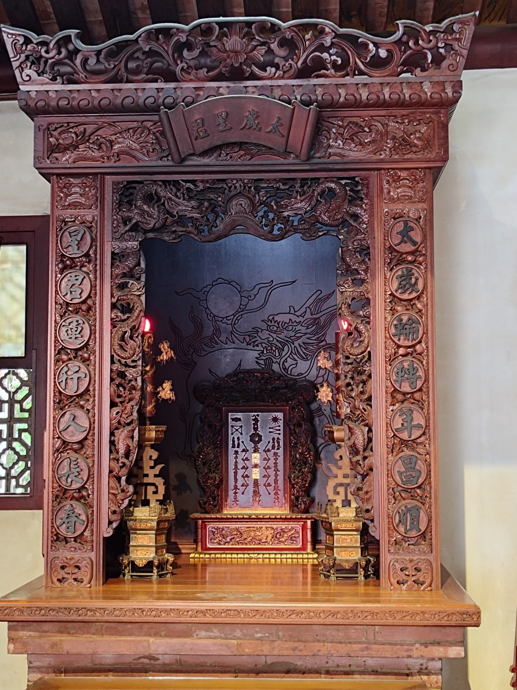

# [XJ-05] 順星消災 — 太歲殿值年太歲星君神位

> **供奉六十甲子太歲星君與斗姥元君，護佑信眾流年順遂、化煞為祥**

- **導覽編號**：`XJ-05` (網址錨點：`#XJ-05`)
- **所屬區域**：祀典興濟宮 — 後殿側廳（太歲殿）
- **主題標籤**：`六十甲子太歲` `安太歲祈福` `流年順遂`
- **展覽照片**：`./XJ05_興濟宮_太歲殿值年太歲星君神位.jpg`

## 一、導覽摘要（繁體中文）
太歲星君掌管人間一年之吉凶禍福。每逢新春，犯太歲（值、沖、刑、害、破）之信眾皆來此安奉太歲、點光明燈，祈求流年平安。

## 二、完整導覽內文（語音朗讀全文）
道教星辰信仰中，以六十甲子干支紀年配祀六十位太歲星君，每年由一位太歲星君輪值掌管當年人間之吉凶禍福，稱為「值年太歲」（俗諺云：「太歲當頭坐，無喜必有禍」）。祀典興濟宮後殿設有莊嚴之「太歲殿」，供奉斗姥元君與值年太歲星君神位。凡生肖年次遇「本命年（值太歲）」或「正沖、偏沖」之信眾，皆會於農曆新春期間前來辦理「安太歲」，並於年尾冬至前後進行「謝太歲」。結合保生大帝護命消災之神威，興濟宮太歲殿成為信眾祈求整年身心健康、出入平安的重要殿堂。

## 三、藝術與信仰看點
- 值年太歲星君神位：每年依農曆干支更替值年星君名號，遵循道教正統安奉科儀。
- 安太歲與謝太歲禮俗：新春祈安、歲末酬神，完整保存府城歲時節俗文化。
- 醫神與星君雙重護佑：兼具流年運勢調順與身體病痛消解之祈福功能。

---

## 四、多國語言版本 (Multilingual Content)

### English (`en`)
- **Title**: Harmonizing Yearly Stars — Taisui Hall & Presiding Yearly Taisui Deity
- **Subtitle**: Enshrining the Sixty Jiazi Taisui Star Lords to bless worshippers with smooth yearly fortune and transform adversity into peace
- **Location**: Sacrificial Official Xingji Temple — Rear Hall Side Chamber (Taisui Hall)
- **Summary**: The Taisui Star Lords govern yearly human fortune. Every Lunar New Year, worshippers whose zodiac signs clash with the yearly cycle come to pacify Taisui and light blessing lamps.
- **Full Guide**: In Taoist astral belief, the 60-year sexagenary cycle (Jiazi) is governed by Sixty Taisui Star Lords, with one deity taking charge each year as the 'Presiding Yearly Taisui' to oversee human fortune and misfortune. Xingji Temple's Rear Hall features a solemn Taisui Hall enshrining Doumu Yuanjun and the Presiding Yearly Taisui tablet. Worshippers whose Chinese zodiac sign falls on their birth-sign year (Benmingnian) or clashes with the annual Taisui visit during the Lunar New Year to perform the 'Pacifying Taisui (An Taisui)' rite, and return at year's end to offer thanksgiving ('Xie Taisui'). Combined with Baosheng Dadi's life-protecting grace, it safeguards worshippers' health and safety throughout the year.
  - Rotating Yearly Taisui Tablet: Updated annually according to the sexagenary calendar following orthodox Taoist ritual.
  - An Taisui & Xie Taisui Customs: Preserves Tainan's seasonal cycle of New Year blessing petitions and year-end thanksgiving.
  - Dual Blessing of Healer & Star Lord: Harmonizes annual astrological fortune while protecting physical health.

### 日本語 (`ja`)
- **名称**: 順星消災 — 太歳殿・値年太歳星君神位
- **副題**: 六十甲子の太歳星君を奉祀し、年回りの厄を除き一年の平穏無事と開運を守護する
- **場所**: 祀典興済宮 — 後殿側庁（太歳殿）
- **概要**: 人間の吉凶禍福を一年ごとに司る太歳星君。毎年春節には当たり年（犯太歳）の参拝者が「安太歳」と光明燈の奉納に訪れ、一年の無病息災を祈る。
- **本文**: 道教の星辰信仰では、干支の六十甲子に対応する六十柱の太歳星君が一年交代で人間界の吉凶禍福を司り、その年の担当神を「値年太歳」と呼びます。祀典興済宮の後殿には「太歳殿」が設けられ、斗姥元君と値年太歳星君の神位が奉祀されています。自身の干支が本命年（値太歳）や冲太歳に当たる参拝者は、旧正月期間に「安太歳」の祈祷を受け、年末に感謝を捧げる「謝太歳」を行います。医神・保生大帝の厄除け・健康守護のご利益と相まって、一年の心身の健康と家内安全を祈る多くの参拝者で賑わいます。
  - 値年太歳星君の神位：毎年旧暦の干支に合わせて担当星君の名号が改められ、正統な道教科儀が執り行われる。
  - 安太歳と謝太歳の習俗：新春の祈願と年末の報謝という台南の歳時記文化を今に伝える。
  - 医神と星君の二重守護：運気の好転とともに、無病息災・身体健全を願う参拝者の心の拠り所。

### 한국어 (`ko`)
- **명칭**: 순성소재 — 태세전 직년태세성군 신위
- **부제**: 육십갑자 태세성군을 봉안하여 한 해의 액운을 물리치고 유년(流年)의 평안과 길상을 수호
- **위치**: 사전흥제궁 — 후전 측청(태세전)
- **요약**: 태세성군은 인간 세상의 한 해 길흉화복을 주관합니다. 매년 정초가 되면 범태세에 해당하는 신도들이 찾아와 안태세(安太歲) 의례를 올리고 광명등을 밝히며 무사평안을 기원합니다.
- **본문**: 도교의 성신 신앙에서는 육십갑자 간지에 대응하는 60위의 태세성군이 매년 번갈아 인간 세상의 길흉화복을 관장하며, 그해의 담당 신을 '직년태세(值年太歲)'라 부릅니다. 사전흥제궁 후전에는 장엄한 '태세전'이 마련되어 두모원군과 직년태세성군 신위를 모시고 있습니다. 자신의 띠가 본명년(직태세)이거나 충(沖)에 해당하는 신도들은 음력 정초에 '안태세(安太歲)' 기도를 올리고 연말에 감사를 드리는 '사태세(謝太歲)'를 행합니다. 의신 보생대제의 호명소재 신위와 결합되어 일 년 내내 심신의 건강과 출입 평안을 기원하는 성소입니다.
  - 직년태세성군 신위: 매년 음력 간지에 따라 당번 성군의 명호가 교체되며 정통 도교 과의를 따릅니다.
  - 안태세와 사태세 세시풍속: 정초의 기안(祈安)과 세말의 보은(酬神)이라는 타이난의 전통 세시 문화를 보존하고 있습니다.
  - 의신과 성군의 이중 가호: 한 해의 운세 조화와 신체 건강 수호를 동시에 기원할 수 있습니다.
