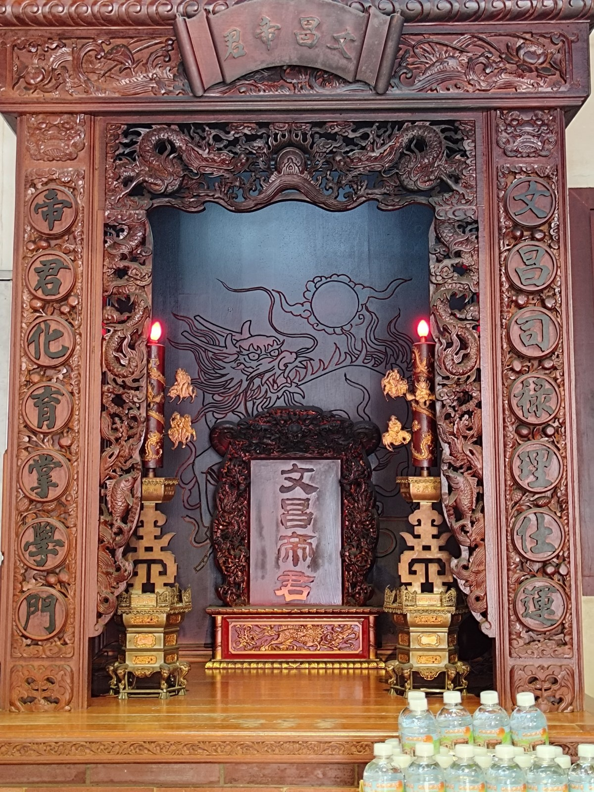

# [XJ-06] 功名開智慧 — 文昌殿文昌帝君神位

> **掌管文運與考選功名，護佑學子金榜題名、醫事與百業專技精進**

- **導覽編號**：`XJ-06` (網址錨點：`#XJ-06`)
- **所屬區域**：祀典興濟宮 — 後殿側龕（文昌殿）
- **主題標籤**：`文昌帝君` `金榜題名` `醫護國考祈願`
- **展覽照片**：`./XJ06_興濟宮_文昌殿文昌帝君神位.jpg`

## 一、導覽摘要（繁體中文）
奉祀主宰功名祿位之文昌帝君。因興濟宮主祀醫神保生大帝，特別吸引眾多醫學院學生、護理師、藥師與各類國考考生前來祈求考運亨通。

## 二、完整導覽內文（語音朗讀全文）
文昌帝君（又稱梓潼帝君、文昌公）為掌管天下文運、學術與考試功名之神明。祀典興濟宮於後殿奉祀文昌帝君，除了護佑一般莘莘學子思緒清明、升學順利外，更因興濟宮主祀「醫神」保生大帝，形成一項極具地方與專業特色的信仰現象：每逢醫師、中醫師、藥師、護理師及醫事檢驗師等國家專門職業高等考試前夕，無數醫護考生皆會專程前來，先向保生大帝祈求醫道傳承與臨床平安，再向文昌帝君祈求考場沉著、金榜題名。案前常可見考生供奉准考證影本、蔥（聰明）、芹菜（勤學）、菜頭（好彩頭）與包粽（包中）。

## 三、藝術與信仰看點
- 醫護考生祈願聖地：結合醫神保生大帝與文昌帝君，為全臺醫事國考學子最青睞之祈福殿堂。
- 文昌開智慧科儀：可攜帶准考證影本與應考文具過香爐祈福，安定考前焦慮心神。
- 儒道崇文傳統：與聖父母殿並列於後殿，體現清代祀典官廟崇尚儒學教化與孝悌之道。

---

## 四、多國語言版本 (Multilingual Content)

### English (`en`)
- **Title**: Wisdom & Academic Success — Wenchang Dijun (God of Literature) Shrine
- **Subtitle**: Presiding over scholarly fortune and examinations, blessing students and medical professionals with wisdom and success
- **Location**: Sacrificial Official Xingji Temple — Rear Hall Side Shrine (Wenchang Hall)
- **Summary**: Enshrining Wenchang Dijun, Lord of Literature and Honors. Because Xingji Temple is dedicated to the God of Medicine, it is especially popular among medical, nursing, and pharmacy students praying for licensing exam success.
- **Full Guide**: Wenchang Dijun (Lord of Zitong) presides over literature, scholarship, and examination honors. Enshrined in Xingji Temple's Rear Hall, he not only blesses students with mental clarity and academic advancement, but—because Xingji Temple is home to the God of Medicine Baosheng Dadi—has fostered a unique tradition: before national licensing examinations for physicians, Traditional Chinese Medicine doctors, pharmacists, nurses, and medical technologists, countless healthcare candidates visit to pray first to Baosheng Dadi for medical vocation blessings and then to Wenchang Dijun for examination triumph. Copies of exam admission tickets alongside symbolic offerings of scallions (intelligence), celery (diligence), and radishes (good omen) fill the altar.
  - Sanctuary for Healthcare Examinees: Uniting the God of Medicine and the God of Literature, making it a favorite shrine for medical licensing candidates.
  - Wisdom-Opening Blessing: Candidates pass admission tickets and stationery over the incense burner to calm pre-exam anxiety.
  - Confucian-Taoist Scholarly Heritage: Situated alongside the Hall of Sacred Parents, reflecting the temple's esteem for learning and virtue.

### 日本語 (`ja`)
- **名称**: 学業成就・開智慧 — 文昌殿・文昌帝君神位
- **副題**: 文運と試験合格を司り、受験生の合格祈願や医療・専門職の技能向上を守護する
- **場所**: 祀典興済宮 — 後殿側龕（文昌殿）
- **概要**: 学問と功名を司る文昌帝君を奉祀。医神・保生大帝の廟であることから、特に医学生・看護師・薬剤師などの国家試験受験生が多く参拝に訪れる。
- **本文**: 文昌帝君（梓潼帝君）は学問・文運・試験合格を司る神様です。祀典興済宮の後殿に祀られる文昌帝君は、一般の学生の学業成就だけでなく、当宮が「医神」保生大帝を主祀とすることから独自の信仰を集めています。医師・中医師（漢方医）・薬剤師・看護師などの国家試験シーズンになると、多くの医療系受験生が訪れ、まず保生大帝に医療の道での加護を祈り、続いて文昌帝君に国家試験合格（金榜題名）を祈願します。供物台には受験票の写しや、知恵と勤勉を象徴するネギ（聡明）・セロリ（勤勉）・大根（好彩頭＝縁起が良い）が数多く供えられます。
  - 医療系受験生の聖地：医神・保生大帝と文昌帝君のご利益が重なり、医療国家試験の受験生から絶大な信仰を集める。
  - 文昌開智慧の祈願：受験票のコピーや筆記用具を香炉の煙にくぐらせ、試験本番での平常心と実力発揮を祈る。
  - 崇文尚学の伝統：聖父母殿と並び後殿に配され、学問と孝道を重んじる祀典官廟の伝統を体現。

### 한국어 (`ko`)
- **명칭**: 학업 성취와 지혜 개창 — 문창전 문창제군 신위
- **부제**: 문운(文運)과 과거 급제를 주관하며, 수험생의 합격과 의료·전문직 종사자의 지혜 증진을 수호
- **위치**: 사전흥제궁 — 후전 측면 감실(문창전)
- **요약**: 학문과 공명을 주관하는 문창제군을 모십니다. 의신 보생대제를 모신 사원이라는 특성 덕분에 의대생, 간호사, 약사 등 보건의료 국가고시 수험생들의 참배가 특히 줄을 잇습니다.
- **본문**: 문창제군(자주제군)은 천하의 문운과 학술, 시험 급제를 관장하는 신입니다. 사전흥제궁 후전에 모셔진 문창제군은 일반 학생들의 학업 성취뿐만 아니라, 주신이 '의신' 보생대제라는 점과 결합하여 독특한 신앙 문화를 형성하고 있습니다. 의사, 한의사, 약사, 간호사 등 보건의료 분야 국가고시를 앞두고 수많은 예비 의료인들이 찾아와 먼저 보생대제께 의술 전승과 임상의 평안을 빌고, 이어 문창제군께 시험 합격(금방제명)을 기원합니다. 제단 앞에는 수험표 사본과 함께 총명(파·蔥), 근면(미나리·芹), 좋은 징조(무·菜頭)를 상징하는 공물이 가득 놓입니다.
  - 보건의료 수험생의 성지: 의신 보생대제와 문창제군의 가호가 결합되어 의료계 국가고시 수험생들이 가장 즐겨 찾는 기원처입니다.
  - 문창 개지혜 기원: 수험표 사본과 필기구를 향로 연기에 쐬며 시험장에서의 평정심과 실력 발휘를 기원합니다.
  - 숭문상학(崇文尙學)의 전통: 성부모전과 나란히 후전에 배치되어 학문과 효도를 중시하는 사전 관묘의 전통을 보여줍니다.
